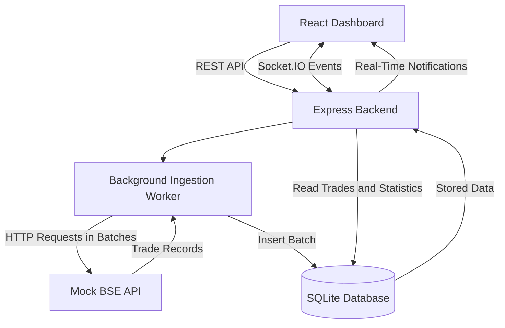

# BSE Trades Dashboard

A real-time trade ingestion and monitoring dashboard built using React, Node.js, Express, SQLite, and Socket.IO.

The application simulates a BSE trade API, retrieves trade records in batches, stores them persistently, and displays ingestion progress in a live dashboard without requiring page refreshes.

## Features

- **Mock BSE API:** Generates 5,000 sample trade records.
- **Batch Processing:** Retrieves trades in batches of 100 records.
- **Background Ingestion:** Starts trade retrieval asynchronously without keeping the initiating HTTP request open.
- **Real-Time Updates:** Uses Socket.IO to notify the dashboard whenever a batch is stored.
- **Persistent Storage:** Stores trade records and ingestion job details in SQLite.
- **Live Dashboard:** Displays trade statistics, ingestion progress, and trade records.
- **Pagination:** Allows users to navigate through stored trade records.
- **Cancellation:** Allows an ongoing trade ingestion process to be stopped.
- **Duplicate Prevention:** Uses trade IDs as primary keys and `INSERT OR IGNORE` during insertion.

## Technology Stack

| Component | Technology |
|---|---|
| Frontend | React, Vite |
| Backend | Node.js, Express |
| Database | SQLite using SQL.js |
| Real-Time Communication | Socket.IO |
| HTTP Client | Axios |
| API | REST |

## Architecture

The application consists of three main components:

1. **Mock BSE API:** Generates sample trade data and exposes a paginated endpoint.
2. **Backend:** Manages ingestion, retrieves batches, stores records, and broadcasts updates.
3. **Frontend:** Displays stored trades, statistics, and real-time ingestion progress.

### Architecture Diagram



## How It Works

1. The user opens the dashboard.
2. The frontend requests existing trade records and statistics from the backend.
3. When the user clicks **Start Trade Pull**, the backend starts an asynchronous ingestion worker and immediately responds to the request.
4. The worker requests trade records from the mock API in batches of 100.
5. Each batch is inserted into the SQLite database and persisted to disk.
6. After storing a batch, the backend emits a Socket.IO event containing ingestion progress.
7. The frontend receives the event and refreshes the displayed records and statistics.
8. The process continues until all available records are retrieved or the user cancels the operation.

### Handling Long-Running Requests

The ingestion process does not depend on one HTTP request remaining open for the entire duration.

Instead, it makes multiple short requests to the mock API using a cursor-based pagination mechanism.

The mock API supports a configurable delay per request, capped at 25 seconds. For example, 50 requests with an 18-second delay each would take approximately 15 minutes in total, while keeping individual requests below the 30-second connection limit.

## Project Structure

```text
bse-trades-dashboard/
│
├── backend/
│   ├── database.js       # Database initialization and operations
│   ├── server.js         # Express API and Socket.IO server
│   ├── worker.js         # Background trade ingestion logic
│   └── trades.db         # Persistent SQLite database (generated)
│
├── frontend/
│   ├── src/
│   │   ├── App.jsx       # Dashboard UI and frontend logic
│   │   ├── App.css       # Dashboard styling
│   │   └── main.jsx      # React application entry point
│   └── package.json
│
├── mock-bse-api/
│   ├── server.js         # Mock BSE API and sample trade generator
│   └── package.json
│
└── README.md
```

## Getting Started

### Prerequisites

- Node.js (v22 or compatible)
- npm
- Git

### 1. Clone the Repository

```bash
git clone https://github.com/YOUR_USERNAME/bse-trades-dashboard.git
cd bse-trades-dashboard
```

Replace `YOUR_USERNAME` with your GitHub username.

### 2. Install Dependencies

Install dependencies in all three project directories:

```bash
cd mock-bse-api
npm install

cd ../backend
npm install

cd ../frontend
npm install
```

### 3. Start the Mock BSE API

Open a terminal:

```bash
cd mock-bse-api
node server.js
```

The mock API runs at:

`http://localhost:4000`

### 4. Start the Backend

Open another terminal:

```bash
cd backend
node server.js
```

The backend runs at:

`http://localhost:5000`

The SQLite database is initialized automatically. Existing database records are loaded when the backend restarts.

### 5. Start the Frontend

Open a third terminal:

```bash
cd frontend
npm run dev
```

Open the Vite development URL, usually:

`http://localhost:5173`

## Configuring API Delay

The mock API supports a configurable delay for each trade retrieval request.

The default delay is 1,000 milliseconds (1 second).

To change it using Git Bash:

```bash
DELAY_MS=2000 node server.js
```

To use an 18-second delay:

```bash
DELAY_MS=18000 node server.js
```

The maximum permitted delay is 25,000 milliseconds.

## API Endpoints

### Mock BSE API — Port 4000

| Method | Endpoint | Description |
|---|---|---|
| GET | `/health` | Checks API health |
| GET | `/getTrades` | Retrieves a batch of trade records |

Example:

```http
GET /getTrades?cursor=0&limit=100
```

The response includes trade records, total record count, cursor information, and whether more records are available.

### Backend API — Port 5000

| Method | Endpoint | Description |
|---|---|---|
| GET | `/api/trades` | Retrieves stored trades |
| GET | `/api/stats` | Returns trade statistics |
| GET | `/api/pulls/status` | Returns the latest ingestion job status |
| POST | `/api/pulls` | Starts trade ingestion |
| POST | `/api/pulls/cancel` | Requests cancellation of active ingestion |

## Database Design

The application uses two SQLite tables.

### 1. trades

Stores the retrieved trade records.

| Column | Description |
|---|---|
| trade_id | Unique trade identifier (Primary Key) |
| client | Client name |
| symbol | Stock symbol |
| quantity | Number of shares |
| price | Trade price |
| timestamp | Trade timestamp |

### 2. pull_jobs

Tracks ingestion job information.

| Column | Description |
|---|---|
| id | Unique job identifier |
| status | Current job status |
| total_trades | Total records available |
| processed_trades | Records processed in the job |
| started_at | Job start time |
| completed_at | Job completion or cancellation time |
| error | Error details, if any |

SQL.js provides a SQLite database compiled to WebAssembly. Database changes are exported and persisted to the `trades.db` file.

## Design Decisions

- **Batch ingestion:** Avoids keeping a single HTTP connection open for a long-running operation.
- **Asynchronous processing:** Allows the backend to accept an ingestion request and return immediately.
- **SQLite persistence:** Retains previously retrieved trade records across backend restarts.
- **Socket.IO:** Pushes ingestion updates to the dashboard without polling.
- **Database as the source of truth:** The frontend retrieves stored records from the backend rather than relying on transient socket messages.
- **Duplicate prevention:** The primary key and `INSERT OR IGNORE` prevent duplicate trade IDs from being inserted.
- **Cancellation support:** Uses `AbortController` to abort an active API request and stop further ingestion.

## Limitations

- The ingestion worker runs asynchronously within the backend process rather than as a separate worker service.
- Automatic recovery and resumption of interrupted jobs after a backend crash are not implemented.
- The mock API generates synthetic trade records and is not connected to the actual BSE exchange.
- The 15-minute scenario is configurable through cumulative per-request delays; it is not a single 15-minute HTTP request.

## Future Improvements

- Implement persistent job recovery and ingestion resumption.
- Move background processing into a dedicated worker service or queue.
- Add authentication and role-based access control.
- Add advanced filtering and search for trade records.
- Add automated tests and deployment pipelines.

## Author

**Justin D'souza**

